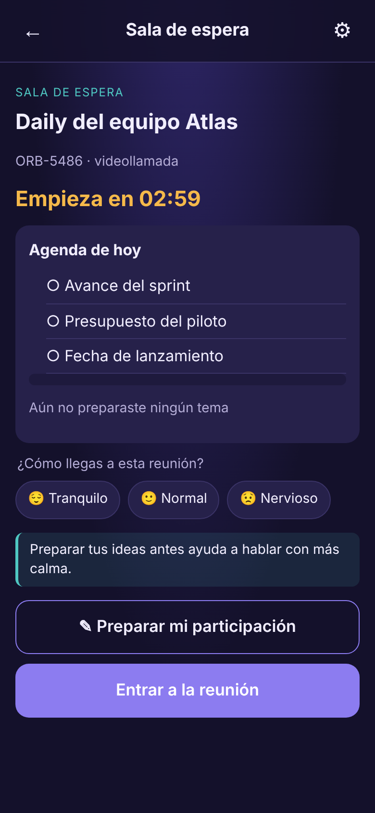
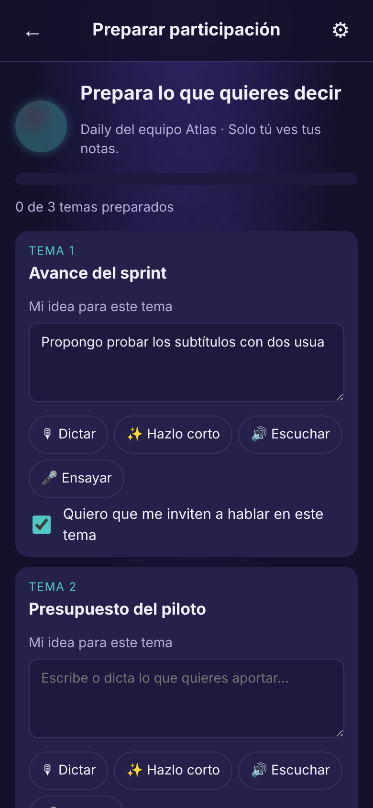
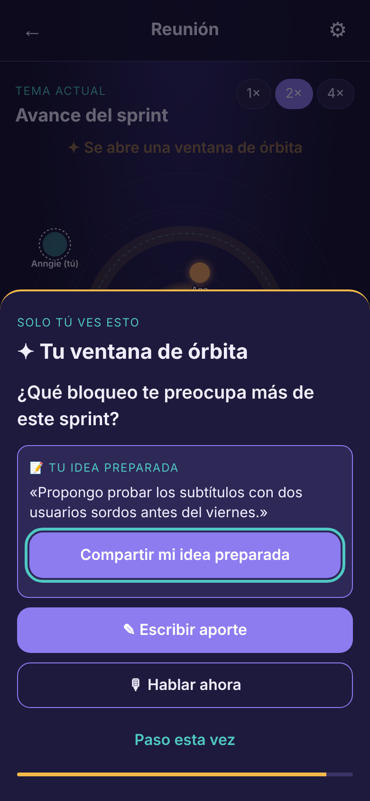
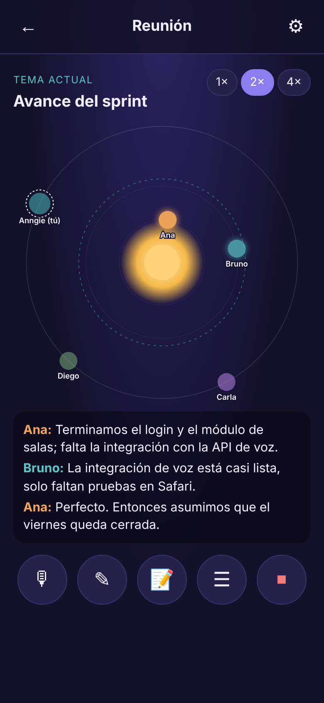
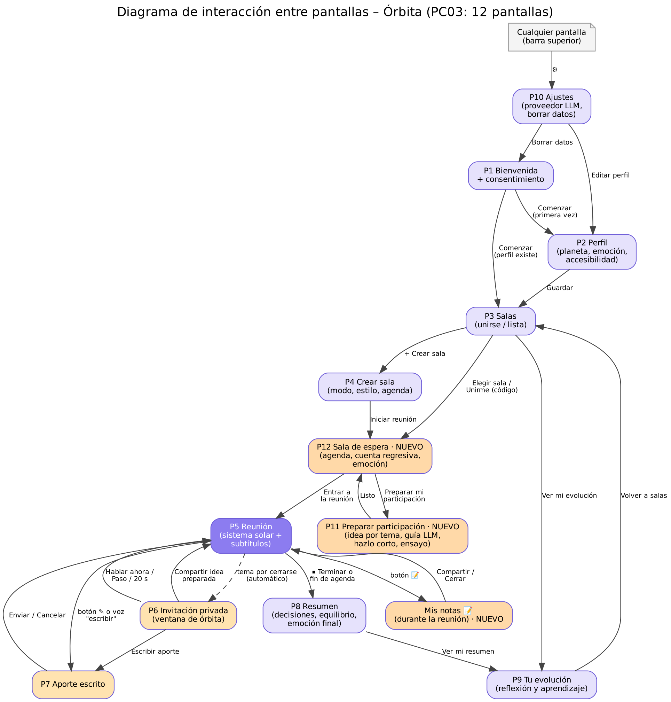

# 🪐 Órbita – reuniones equilibradas

> *Que todas las voces encuentren su órbita.*

 -8C7CF0) 

**Órbita** es una aplicación web progresiva (PWA) que equilibra la participación en reuniones. Cada participante es un **planeta**: su distancia al sol muestra cuánto ha participado, sin números ni rankings. Antes de que se cierre un tema, Órbita abre una **ventana de órbita**: invita **en privado** a quienes no han aportado, con una pregunta concreta generada por un LLM, y les deja elegir entre **hablar, escribir o pasar**.

**Nuevo en la v0.7:** cada persona puede **preparar su participación antes de la reunión**: escribe o dicta su idea por tema, pide al asistente que la deje corta, la ensaya en voz alta y luego la comparte con un toque cuando llega su ventana de órbita.

Proyecto del curso **CC451 – Interacción Humano Computador** (UNI, Facultad de Ciencias, 2026-2).

| Sala de espera | Preparar participación | Ventana de órbita con idea preparada | Reunión |
|---|---|---|---|
|  |  |  |  |

## ✨ Requerimientos comunes del curso

| Requerimiento | Cómo lo cumple Órbita | Archivo |
|---|---|---|
| **Interfaz no convencional** | Sistema solar de la reunión (SVG): distancia = participación, brillo = aporte reciente, anillo de equilibrio | `js/orbits.js` |
| **Interfaz de voz** | Reconocimiento (Web Speech API, `es-PE`), comandos de voz, dictado y ensayo de ideas, lectura en voz alta (TTS) | `js/voice.js`, `js/prep.js` |
| **LLM con capa de abstracción** | `LLM.generar(tarea, datos)` con 3 proveedores intercambiables: **Simulado**, **Gemini** (remoto) y **Ollama** (local); *fallback* automático y validador de tono | `js/llm.js` |
| **PWA** | `manifest.webmanifest`, service worker con caché *offline*, instalable en laptop y móvil | `sw.js` |
| **Personalización continua** | Perfil persistente que aprende: canal preferido, tiempo de invitación, ritmo de habla, emociones declaradas e inferidas, ideas preparadas | `js/profile.js`, `js/prep.js` |
| **Multiusuario** | Salas con código y aportes entre pestañas del mismo navegador mediante BroadcastChannel | `js/room.js` |
| **Diseño emocional (Norman)** | Visceral: paleta espacial cálida, planetas que brillan. Conductual: 1 toque, microinteracciones ≤ 300 ms. Reflexivo: resumen personal ("Preparaste 2 ideas y compartiste 1") | `css/styles.css`, `js/app.js` |
| **Accesibilidad** | Subtítulos con nombre, lista accesible, aporte escrito, vibración, alto contraste, baja estimulación, teclado | todo |

## 🚀 Inicio rápido

```bash
git clone https://github.com/USUARIO/orbita-pwa.git
cd orbita-pwa
python3 -m http.server 8000      # o la extensión Live Server de VS Code
```

Abre <http://localhost:8000> y pulsa **«Ver simulación guiada»** (o entra a `http://localhost:8000/?demo=1`). La demo usa un perfil temporal, voz simulada y el proveedor simulado. Para probar el micrófono y un LLM real, entra con **Comenzar**.
Guía completa: **[docs/INSTALACION.md](docs/INSTALACION.md)**.

## 🧪 Pruebas

```bash
node tests/run.js        # o: npm test
```

22 pruebas automáticas sin dependencias cubren la capa LLM, el perfil persistente, la preparación, el índice de equilibrio y los datos simulados. El flujo de GitHub Actions las ejecuta en cada *push* (`.github/workflows/pruebas.yml`).

## 🧭 Flujo de la aplicación (12 pantallas)

`P1 Bienvenida → P2 Perfil → P3 Salas → P4 Crear sala → P12 Sala de espera ⇄ P11 Preparar participación → P5 Reunión ⇄ P6 Invitación / P7 Aporte escrito / Mis notas → P8 Resumen → P9 Tu evolución` · `P10 Ajustes` desde cualquier pantalla.



## 📊 Estado del proyecto (PC03)

| Módulo | Estado |
|---|---|
| Interfaz y navegación, interfaz orbital, capa LLM, voz, perfil, preparación, PWA | ✅ Funcionando |
| Multiusuario | 🟡 Entre pestañas (BroadcastChannel); Supabase Realtime en curso |
| Detección de hablantes | 🟡 Simulada con el guion; diarización real en curso |
| Panel del facilitador, historial de reuniones, tutorial, gestión de miembros | ⏳ Para la entrega final |

**Pantallas programadas: 12 de 16 (75 %).** Detalle en el [CHANGELOG](CHANGELOG.md).

## 🏗 Arquitectura

Diagramas C4 en **[docs/ARQUITECTURA.md](docs/ARQUITECTURA.md)**.

```
orbita-pwa/
├── index.html              # 12 pantallas + 3 modales
├── manifest.webmanifest    # PWA
├── sw.js                   # service worker (offline)
├── css/styles.css          # diseño visual y accesibilidad
├── js/
│   ├── app.js              # controlador de pantallas
│   ├── prep.js             # preparación de la participación (NUEVO)
│   ├── orbits.js           # interfaz orbital (SVG)
│   ├── room.js             # motor de reunión + multiusuario
│   ├── llm.js              # capa de abstracción LLM
│   ├── voice.js            # voz (STT, TTS, comandos)
│   ├── profile.js          # perfil persistente
│   └── demo.js             # simulación guiada
├── tests/run.js            # 22 pruebas automáticas
├── data/                   # datos simulados (JSON + simulated.js)
├── icons/                  # íconos PWA
└── docs/                   # arquitectura, instalación, diagramas, capturas
```

## 🔒 Privacidad

- No se guarda audio; la transcripción se borra al salir salvo que el usuario la descargue.
- Las ideas preparadas se guardan en el navegador y «Hazlo corto» las procesa en el dispositivo. Al compartir una idea, se incorpora a la reunión y puede formar parte del contexto enviado al proveedor seleccionado.
- La clave de Gemini se mantiene en memoria durante el uso de la pestaña.
- **Ajustes → Borrar todos mis datos** elimina todo.

## 👥 Equipo

| Integrante | Rol principal |
|---|---|
| Anngie Salazar | Usuarios y requerimientos; preparación de la participación y perfil persistente |
| Gabriel Rincón | Historias de usuario y trazabilidad; reunión, voz, capa LLM y multiusuario; pruebas |
| Fernando Mora | Diseño y prototipo; PWA, diseño emocional, accesibilidad, arquitectura y repositorio |

## 📄 Licencia

[MIT](LICENSE) © 2026 Equipo Órbita.
