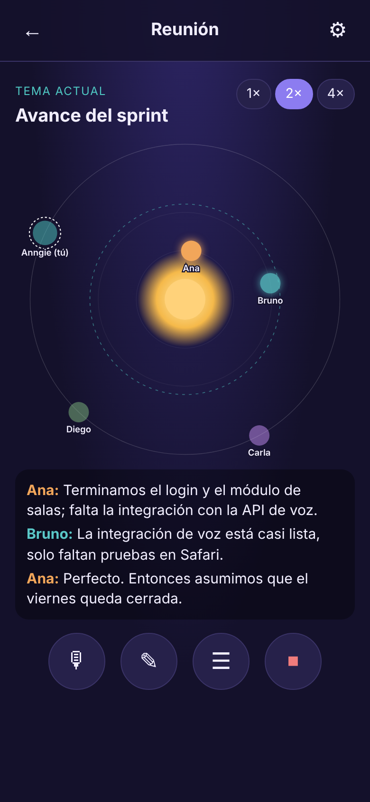
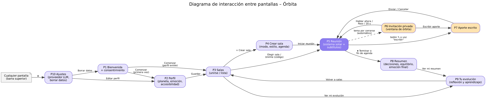

# 🪐 Órbita – reuniones equilibradas

> *Que todas las voces encuentren su órbita.*

**Órbita** es una aplicación web progresiva (PWA) que equilibra la participación en reuniones. Cada participante es un **planeta**: su distancia al sol muestra cuánto ha participado, sin números ni rankings. Antes de que se cierre un tema, Órbita abre una **ventana de órbita**: invita **en privado** a quienes no han aportado, con una pregunta concreta generada por un LLM, y les deja elegir entre **hablar, escribir o pasar**.

Proyecto del curso **CC451 – Interacción Humano Computador** (UNI, Facultad de Ciencias, 2026-2).



## ✨ Características (requerimientos comunes del curso)

| Requerimiento | Cómo lo cumple Órbita | Archivo |
|---|---|---|
| **Interfaz no convencional** | Sistema solar de la reunión (SVG): distancia = participación, brillo = aporte reciente, anillo de equilibrio | `js/orbits.js` |
| **Interfaz de voz** | Reconocimiento (Web Speech API, `es-PE`), comandos de voz ("pedir la palabra", "escribir", "resumen", "paso"), lectura en voz alta (TTS) | `js/voice.js` |
| **LLM con capa de abstracción** | Interfaz única `LLM.generar(tarea, datos)` con 3 proveedores intercambiables: **Simulado**, **Gemini** (remoto) y **Ollama** (local); *fallback* automático y validador de tono no punitivo | `js/llm.js` |
| **PWA** | `manifest.webmanifest`, service worker con caché *offline*, instalable en laptop y móvil | `sw.js` |
| **Personalización continua** | Perfil persistente que aprende: canal preferido, tiempo de invitación, ritmo de habla, emociones declaradas e inferidas | `js/profile.js` |
| **Multiusuario** | Salas con código; sincronización entre pestañas/dispositivos (BroadcastChannel en el prototipo, Supabase Realtime en producción) | `js/room.js` |
| **Diseño emocional (Norman)** | Visceral: paleta espacial cálida y planetas que brillan. Conductual: respuesta en 1 toque, microinteracciones ≤ 300 ms. Reflexivo: resumen personal y evolución del equilibrio | `css/styles.css`, `js/app.js` |
| **Accesibilidad** | Subtítulos con nombre del hablante, lista accesible para lectores de pantalla, aporte escrito, vibración, alto contraste, baja estimulación, navegación por teclado | todo |

## 🚀 Inicio rápido

```bash
git clone https://github.com/<usuario>/orbita-pwa.git
cd orbita-pwa
python -m http.server 8000      # o la extensión Live Server de VS Code
```

Abre <http://localhost:8000> y pulsa **"▶ Ver simulación guiada"** (o entra a `http://localhost:8000/?demo=1`).
La guía completa está en **[docs/INSTALACION.md](docs/INSTALACION.md)**.

> También funciona abriendo `index.html` con doble clic (sin instalación offline ni multiusuario).

## 🧭 Flujo de la aplicación (10 pantallas)

`P1 Bienvenida → P2 Perfil → P3 Salas → P4 Crear sala → P5 Reunión ⇄ P6 Invitación privada / P7 Aporte escrito → P8 Resumen → P9 Tu evolución` · `P10 Ajustes` desde cualquier pantalla.



## 🏗 Arquitectura

Diagramas C4 (contexto y contenedores) en **[docs/ARQUITECTURA.md](docs/ARQUITECTURA.md)**.

```
orbita-pwa/
├── index.html              # 10 pantallas + 2 modales
├── manifest.webmanifest    # PWA
├── sw.js                   # service worker (offline)
├── css/styles.css          # diseño visual y accesibilidad
├── js/
│   ├── app.js              # controlador de pantallas
│   ├── orbits.js           # interfaz orbital (SVG)
│   ├── room.js             # motor de reunión + multiusuario
│   ├── llm.js              # capa de abstracción LLM
│   ├── voice.js            # voz (STT, TTS, comandos)
│   ├── profile.js          # perfil persistente
│   └── demo.js             # simulación guiada
├── data/                   # datos simulados (JSON + simulated.js)
├── icons/                  # íconos PWA
├── LICENSE                 # licencia MIT
└── docs/                   # informe, arquitectura, instalación y diagramas
```

## 📑 Informe del proyecto

El informe está disponible en [Word](docs/CC451-PC02-Informe-Orbita.docx) y [PDF](docs/CC451-PC02-Informe-Orbita.pdf).

## 🧪 Datos simulados

La carpeta `data/` incluye una reunión completa simulada: 4 participantes (Ana domina, Diego casi no habla), 3 salas, una agenda de 3 temas, un guion de 13 intervenciones, un historial de 4 reuniones y un perfil de ejemplo. No se necesita micrófono ni API key para ver todo el flujo.

## 🔒 Privacidad

- No se guarda audio; la transcripción se borra al salir salvo que el usuario la descargue.
- El perfil vive solo en el navegador (`localStorage`) y se borra desde **Ajustes → Borrar todos mis datos**.
- La API key de Gemini se guarda solo en el navegador del usuario.

## 👥 Equipo

| Integrante | Rol principal |
|---|---|
| Anngie Salazar | Análisis de usuarios, PACT, requerimientos FR/NFR, sistemas similares |
| Gabriel Rincón | Historias de usuario, matriz de trazabilidad, criterios de usabilidad |
| Fernando Mora | Alternativas de diseño, prototipo, simulación, repositorio |

## 📄 Licencia

[MIT](LICENSE) © 2026 Equipo Órbita.
