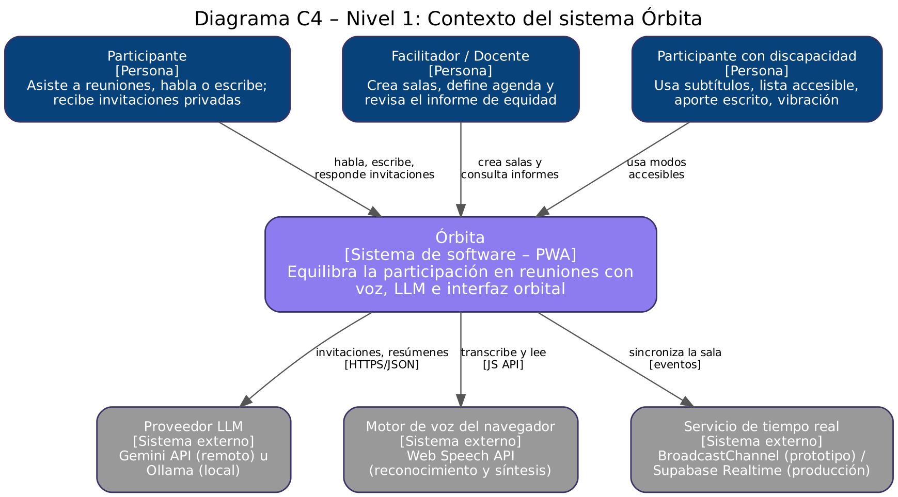
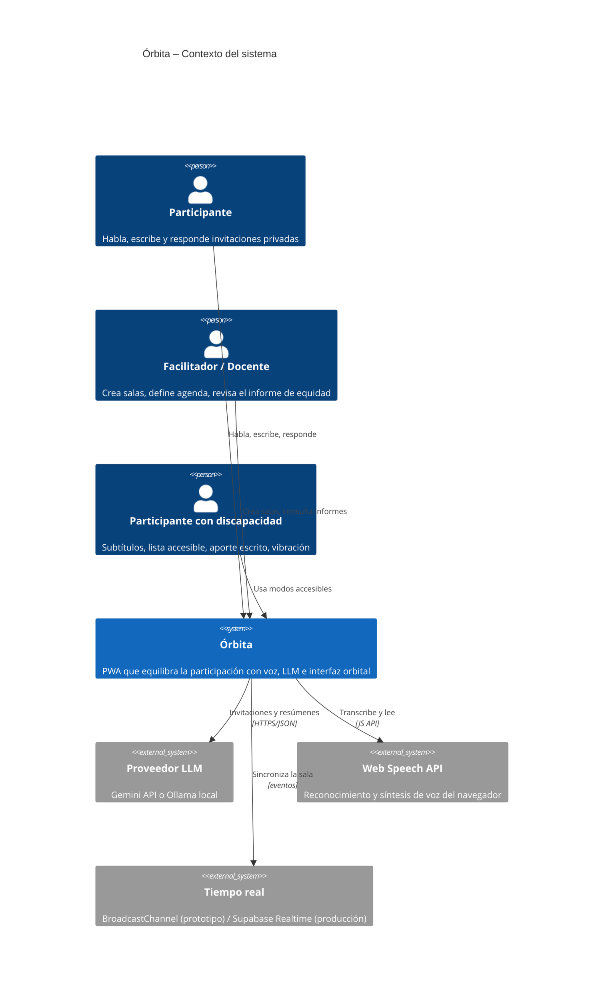
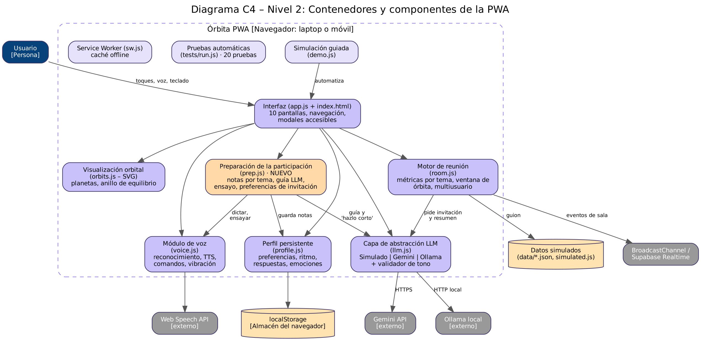
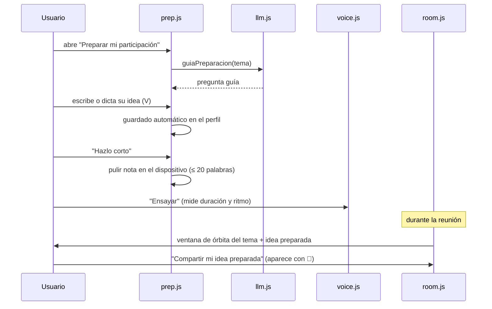
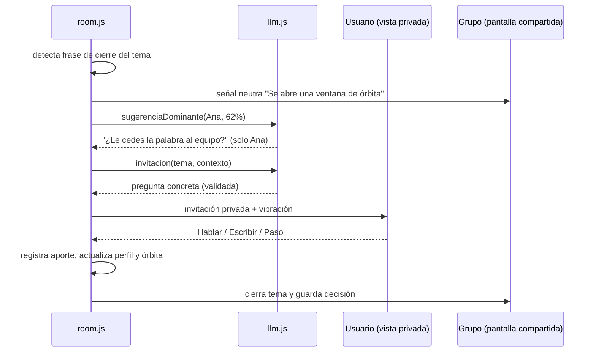

# Arquitectura de Órbita (modelo C4)

## Nivel 1 – Contexto del sistema

## Nivel 2 – Contenedores y componentes

| Componente | Responsabilidad | Requerimientos |
|---|---|---|
| `app.js` | Navegación entre las 10 pantallas, modales accesibles, foco y teclado | RF-22, RF-29, RNF-04 |
| `orbits.js` | Dibuja el sistema solar en SVG; lista accesible equivalente | RF-07, RF-08, RF-19 |
| `room.js` | Mide participación por persona y por tema; detecta cierre de tema; abre la ventana de órbita; multiusuario | RF-01, RF-02, RF-09 a RF-13 |
| `llm.js` | Capa de abstracción: `generar(tarea, datos)` con proveedores Simulado, Gemini y Ollama; *fallback*; validador de tono | RF-11, RF-20, RF-21, RNF-08 |
| `voice.js` | Reconocimiento de voz, comandos, TTS y vibración | RF-04 a RF-06, RF-18 |
| `profile.js` | Perfil persistente que aprende del uso | RF-14 a RF-17 |
| `sw.js` | Caché *offline* del *app shell* | RNF-01 |
| `prep.js` | **Nuevo.** Preparación de la participación: notas por tema, pregunta guía y "Hazlo corto" con el LLM, dictado y ensayo con voz, preferencia de invitación por tema, sala de espera | RF-30 a RF-37, RNF-16 |
| `demo.js` | Simulación guiada del flujo completo (12 pasos) con datos simulados | RF-24 |
| `tests/run.js` | 22 pruebas automáticas de la lógica (sin dependencias) | RNF-12 |

## Flujo de la preparación de la participación

## Decisiones de arquitectura

1. **Sin framework ni build.** HTML, CSS y JavaScript puros: la app corre en cualquier laptop o celular sin `npm install`, y se publica tal cual en GitHub Pages.
2. **Capa de abstracción del LLM.** Las pantallas nunca llaman a un proveedor directamente. Cambiar de Gemini a Ollama (o a otro) es agregar un objeto con el método `generar()`.
3. **Degradación elegante.** Sin voz → texto. Sin LLM → proveedor simulado. Sin red → caché del service worker. Sin `localStorage` → perfil en memoria.
4. **Privacidad por diseño.** No se guarda audio; las invitaciones son privadas; el perfil vive en el dispositivo.
5. **La preparación es privada y local.** El navegador guarda y acorta las notas en el dispositivo. Cuando la persona comparte una, se incorpora a la reunión y puede formar parte del contexto del LLM.
6. **Lógica separada de la interfaz.** `Preparacion`, `Perfil`, `LLM` y `Sala.indiceEquilibrio` no dependen del DOM, por eso se prueban con `node tests/run.js`.
7. **Tiempo real intercambiable.** El prototipo usa `BroadcastChannel` (mismo navegador); en producción se reemplaza por Supabase Realtime o WebSocket sin cambiar la interfaz de `room.js`.

## Flujo de la ventana de órbita (secuencia)

## Backend del asistente de voz

El servidor Node.js sirve la PWA y expone la API local del asistente. `js/asistente.js` graba con `MediaRecorder`, permite revisar el texto y reproduce las respuestas en un control de audio. `backend/gemini.cjs` conecta las tres operaciones con Gemini usando la clave del servidor.

| Ruta | Función |
|---|---|
| `GET /api/asistente/estado` | Informa si el servidor tiene una clave configurada |
| `POST /api/asistente/transcribir` | Recibe una grabación y devuelve el texto |
| `POST /api/asistente/responder` | Recibe el mensaje, el tema opcional y hasta ocho turnos previos |
| `POST /api/asistente/voz` | Devuelve la respuesta hablada en formato WAV |

El asistente conserva los turnos en memoria en el navegador y descarta la conversación al salir. El backend opera sin base de datos y la API queda fuera del caché de la PWA.

La reunión usa la misma credencial del servidor. `GET /api/reunion/estado` informa si Gemini está habilitado por configuración. `POST /api/reunion/generar` recibe el tipo de tarea y los campos necesarios para construir la solicitud. La preferencia de proveedor de la reunión se guarda en el perfil local.
