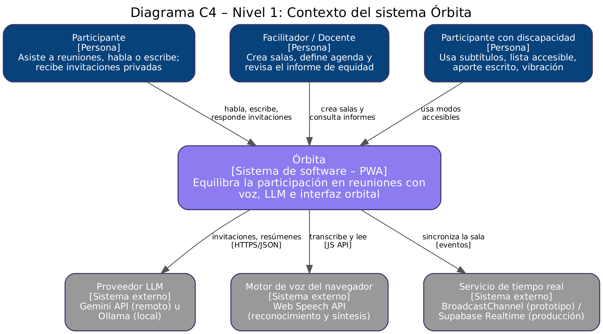
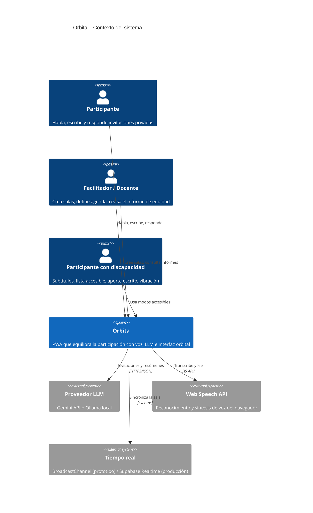
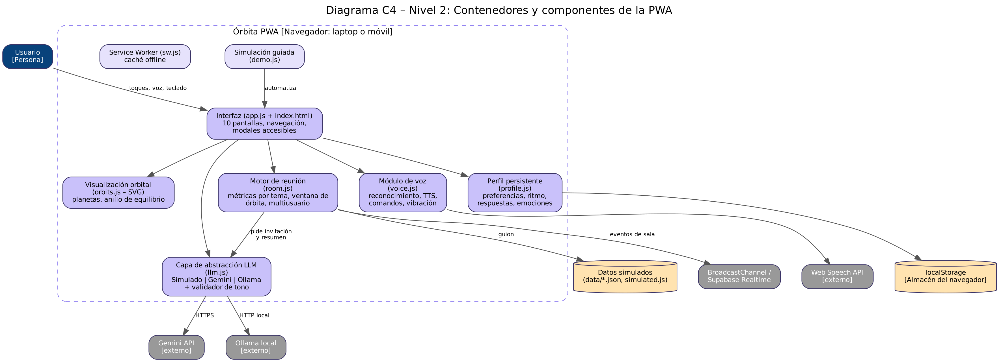
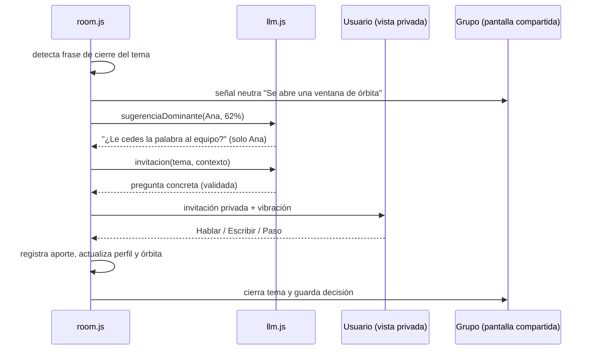

# Arquitectura de Órbita (modelo C4)

## Nivel 1 – Contexto del sistema

## Nivel 2 – Contenedores y componentes

| Componente | Responsabilidad | Requerimientos |
|---|---|---|
| `app.js` | Navegación entre las 10 pantallas, modales accesibles, foco y teclado | RF-22, RF-29, RNF-04 |
| `orbits.js` | Dibuja el sistema solar en SVG; lista accesible equivalente | RF-07, RF-08, RF-19 |
| `room.js` | Mide participación por persona y por tema; detecta cierre de tema; abre la ventana de órbita; multiusuario | RF-01, RF-02, RF-09 a RF-13 |
| `llm.js` | Capa de abstracción: `generar(tarea, datos)` con proveedores Simulado, Gemini y Ollama; *fallback*; validador de tono | RF-11, RF-20, RF-21, RNF-08 |
| `voice.js` | Reconocimiento de voz, comandos, TTS y vibración | RF-04 a RF-06, RF-18 |
| `profile.js` | Perfil persistente que aprende del uso | RF-14 a RF-17 |
| `sw.js` | Caché *offline* del *app shell* | RNF-01 |
| `demo.js` | Simulación guiada del flujo completo con datos simulados | RF-24 |

## Decisiones de arquitectura

1. **Sin framework ni build.** HTML, CSS y JavaScript puros: la app corre en cualquier laptop o celular sin `npm install`, y se publica tal cual en GitHub Pages.
2. **Capa de abstracción del LLM.** Las pantallas nunca llaman a un proveedor directamente. Cambiar de Gemini a Ollama (o a otro) es agregar un objeto con el método `generar()`.
3. **Degradación elegante.** Sin voz → texto. Sin LLM → proveedor simulado. Sin red → caché del service worker. Sin `localStorage` → perfil en memoria.
4. **Privacidad por diseño.** No se guarda audio; las invitaciones son privadas; el perfil vive en el dispositivo.
5. **Tiempo real intercambiable.** El prototipo usa `BroadcastChannel` (mismo navegador); en producción se reemplaza por Supabase Realtime o WebSocket sin cambiar la interfaz de `room.js`.

## Flujo de la ventana de órbita (secuencia)

