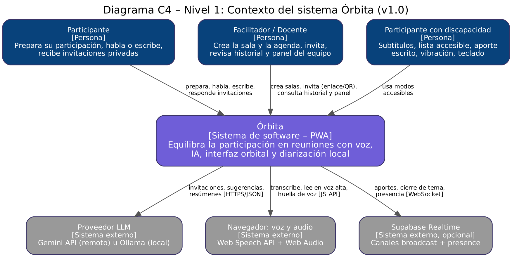
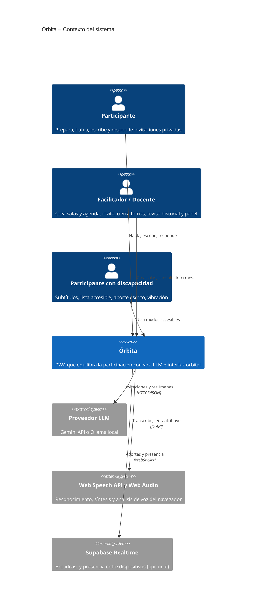
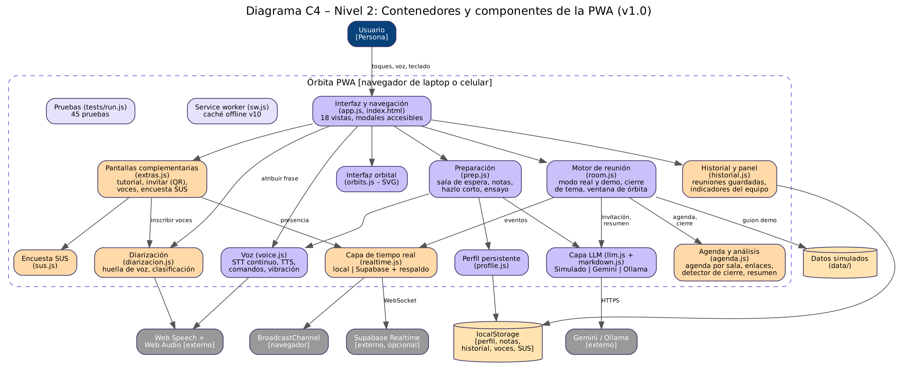
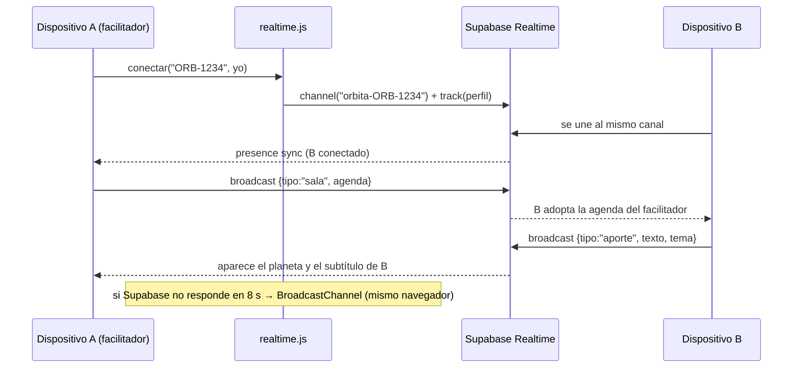
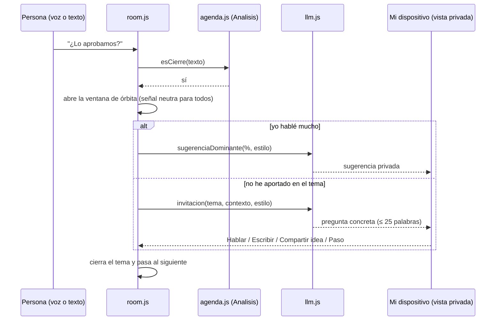
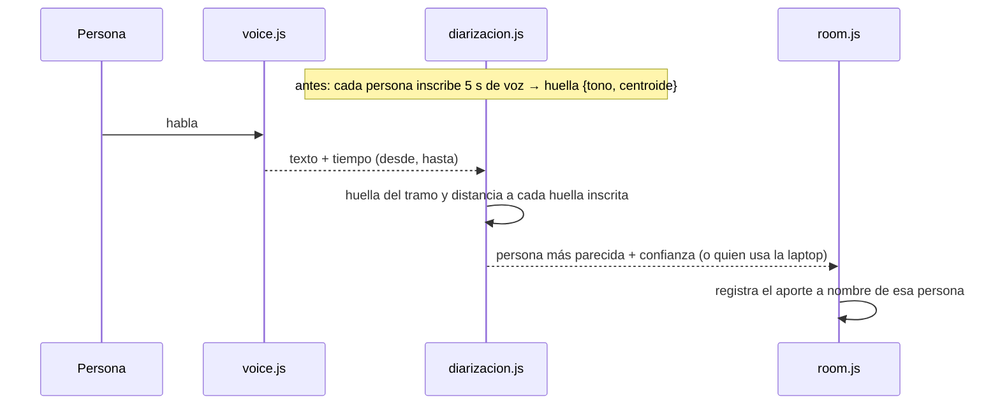
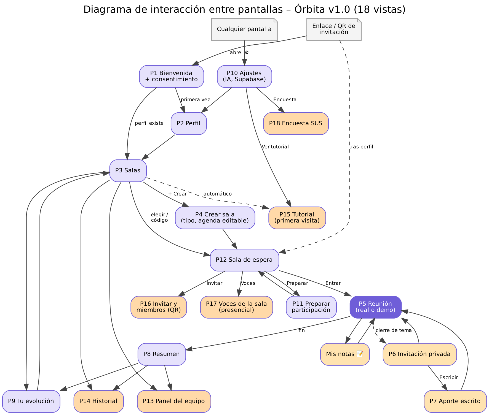

# Arquitectura de Órbita (modelo C4) · v1.0

## Nivel 1 – Contexto del sistema

## Nivel 2 – Contenedores

Órbita es una sola aplicación web estática (sin servidor propio). Los contenedores son:

| Contenedor | Tecnología | Función |
|---|---|---|
| App PWA | HTML, CSS y JavaScript sin *build* | Toda la interfaz y la lógica |
| Service worker | `sw.js` (caché `orbita-v10`) | Funcionamiento *offline* |
| Almacenamiento local | `localStorage` | Perfil, notas, voces inscritas, historial, respuestas SUS |
| Supabase Realtime (opcional) | supabase-js 2 (en `vendor/`) | Canal `orbita-<código>` con broadcast y presencia |
| Proveedor LLM (opcional) | Gemini `gemini-3.5-flash-lite` u Ollama | Invitaciones, sugerencias, resúmenes |

## Nivel 3 – Componentes

| Componente | Responsabilidad | Requerimientos |
|---|---|---|
| `app.js` | Navegación entre 18 vistas, modales accesibles, foco, teclado, micrófono presencial | RF-22, RNF-04 |
| `agenda.js` | Agenda por sala, enlace de invitación, detección de frases de cierre, resumen sin IA | RF-10, RF-29, RF-43 |
| `room.js` | Motor de la reunión: participación por persona y tema, ventana de órbita, reunión real o demo | RF-01, RF-09 a RF-13, RF-45 |
| `realtime.js` | Transporte intercambiable: BroadcastChannel o Supabase Realtime, con respaldo local | RF-02, RF-42, RF-44 |
| `diarizacion.js` | Huella de voz (tono y centroide espectral) y atribución de frases | RF-41, RNF-06 |
| `orbits.js` | Sistema solar en SVG y lista accesible equivalente | RF-07, RF-08, RF-19 |
| `llm.js` | `generar(tarea, datos)` con Simulado, Gemini y Ollama; *fallback*, tono, estilo y límite de 25 palabras | RF-11, RF-20, RF-21, RNF-08 |
| `voice.js` | Reconocimiento (también continuo), comandos, TTS y vibración | RF-04 a RF-06, RF-18 |
| `profile.js` | Perfil persistente que aprende del uso | RF-14 a RF-17 |
| `prep.js` | Preparar la participación y sala de espera | RF-30 a RF-37 |
| `historial.js` | Historial de reuniones, estadísticas del equipo y recomendaciones | RF-25, RF-38, RF-39 |
| `extras.js` + `sus.js` | Tutorial, miembros y QR, inscripción de voces, encuesta SUS | RF-34, RF-40, RF-46 |
| `demo.js` | Simulación guiada (14 pasos) | RF-24 |
| `tests/run.js` | 45 pruebas automáticas sin dependencias | RNF-12 |

## Tiempo real

`room.js` solo conoce la interfaz `{ enviar(mensaje), cerrar() }`; por eso cambiar de transporte no toca el motor de la reunión. Sin credenciales se usa BroadcastChannel.

## Ventana de órbita en una reunión real

Cada dispositivo calcula y muestra solo **su propia** invitación; nadie ve a quién se invitó.

## Modo presencial con una laptop

## Decisiones de arquitectura

1. **Sin framework ni build.** Corre en cualquier laptop o celular y se publica tal cual en GitHub Pages.
2. **Capa de abstracción del LLM.** Las pantallas nunca llaman a un proveedor directamente.
3. **Capa de abstracción del tiempo real.** BroadcastChannel y Supabase comparten la misma interfaz; Supabase es opcional.
4. **Degradación elegante.** Sin voz → texto. Sin LLM → simulado. Sin red → caché. Sin Supabase → local. Sin huellas → se atribuye a quien usa el dispositivo.
5. **Privacidad por diseño.** No se guarda audio; invitaciones privadas; perfil, voces e historial en el dispositivo; el enlace solo lleva nombre, modo y agenda.
6. **Lógica separada de la interfaz.** `Agenda`, `Analisis`, `Realtime`, `Diarizacion`, `Historial`, `SUS`, `LLM` y `Sala` se prueban con Node sin navegador.
7. **Sin rankings.** El panel del equipo muestra solo datos agregados.

## Diagrama de pantallas

Las fuentes Graphviz están en `docs/diagramas/`.
